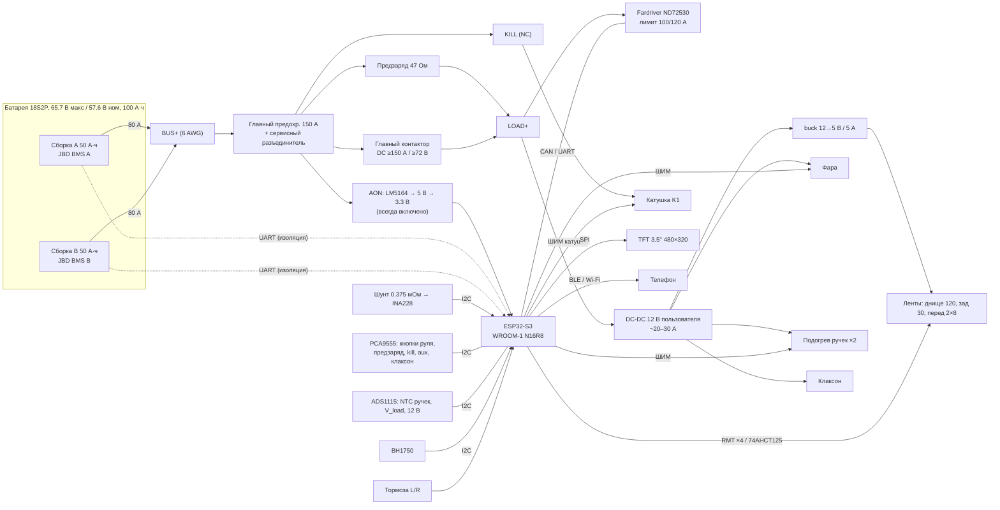

# Smart E-Bike — умный электровелосипед на ESP32-S3

Открытый проект «умной» электрики для электровелосипеда: единый контроллер на **ESP32-S3** управляет
светом, сигналами поворотов, подсветкой днища, дисплеем и кнопками руля, подогревом ручек, **главным контактором с предзарядом**
и следит за батареей **18S2P (2 × 50 А·ч, 2 × JBD BMS)**. Контроллер мотора — Fardriver ND72530 (план).

> Быстрая зарядка от станций постоянного тока **GB/T DC** — отдельная ветка [`charger-gbt`](charger/README.md).

## Модули

| # | Модуль | Документация | Прошивка | Схема |
|---|---|---|---|---|
| 1 | Ядро контроллера ESP32-S3 (питание, шины, FreeRTOS, конфиг, OTA) | [docs/core](docs/core/README.md) | [lib/core](firmware/lib/core) | [hardware/core.md](hardware/core.md) |
| 2 | Счётчик заряда/разряда (INA228 + шунт + 2 × JBD BMS) | [docs/battery-meter](docs/battery-meter/README.md) | [lib/battery_meter](firmware/lib/battery_meter) | [hardware/battery-meter.md](hardware/battery-meter.md) |
| 3 | Подсветка днища (WS2812B/SK6812) | [docs/underglow](docs/underglow/README.md) | [lib/underglow](firmware/lib/underglow) | [hardware/leds.md](hardware/leds.md) |
| 4 | Задний стоп-сигнал + поворотники на ленте | [docs/rear-light](docs/rear-light/README.md) | [lib/rear_light](firmware/lib/rear_light) | [hardware/leds.md](hardware/leds.md) |
| 5 | Передние электронные поворотники | [docs/front-turn](docs/front-turn/README.md) | [lib/front_turn](firmware/lib/front_turn) | [hardware/leds.md](hardware/leds.md) |
| 6 | Автосвет: датчик освещённости + переключатель OFF/AUTO/ON | [docs/auto-light](docs/auto-light/README.md) | [lib/auto_light](firmware/lib/auto_light) | [hardware/auto-light.md](hardware/auto-light.md) |
| 7a | Дисплей 3.5" ILI9488 480×320 SPI (LVGL), альтернатива 4" ST7796S | [docs/display](docs/display/README.md) | [lib/display](firmware/lib/display) | [hardware/display.md](hardware/display.md) |
| 7b | Кнопки на руле (PCA9555 / ADC-лестница / GPIO) | [docs/buttons](docs/buttons/README.md) | [lib/buttons](firmware/lib/buttons) | [hardware/buttons.md](hardware/buttons.md) |
| 8 | Главный контактор + предзаряд + kill + сон «мозга» | [docs/power](docs/power/README.md) | [lib/power](firmware/lib/power) | [hardware/power.md](hardware/power.md) |
| 9 | Подогрев ручек 12 В (NTC, уровни, таймер) | [docs/grips](docs/grips/README.md) | [lib/grips](firmware/lib/grips) | [hardware/grips.md](hardware/grips.md) |
| — | Быстрая зарядка GB/T DC | ветка `charger-gbt` | — | — |

Общая архитектура — [docs/ARCHITECTURE.md](docs/ARCHITECTURE.md), разбивка задач (готовы к переносу в GitHub Issues) — [docs/TASKS.md](docs/TASKS.md), **таблица подключений** — [docs/WIRING.md](docs/WIRING.md), **открытые вопросы** — [docs/OPEN_QUESTIONS.md](docs/OPEN_QUESTIONS.md).

## Структурная схема



## Перечень компонентов (BOM, типовой)

| Узел | Компонент | Кол-во | Примечание |
|---|---|---|---|
| МК | ESP32-S3-WROOM-1-N16R8 (DevKitC-1 для прототипа) | 1 | 16 МБ flash, 8 МБ PSRAM |
| **Силовая часть** | | | |
| Провод силовой | **6 AWG (13.3 мм²)** силикон, красный/чёрный | ~2–3 м | по трассе пакет → контроллер |
| Наконечники | медные лужёные под 6 AWG, M6/M8 + термоусадка с клеем | ~12 | обжим шестигранником |
| Предохранители сборок | 80 А, **DC ≥ 80 В** (напр. Bussmann ANN-80) + держатели | 2 | у клемм сборок |
| Главный предохранитель | 150 А, **DC ≥ 80 В** (напр. ANN-150) + держатель | 1 | ANL/MEGA 32 В — не подходят |
| Сервисный разъединитель | ключ батареи ≥ 150 А DC или anti-spark AS150/QS8 | 1 | |
| Главный контактор | DC, ≥ 150 А длит., ≥ 72 В DC (лучше 100+ В), катушка 12 В, aux-контакт | 1 | класс TE EV200 / Gigavac GX |
| Предзаряд | PhotoMOS/SSR ≥ 100 В DC ≥ 2 А + резистор 47 Ом 50 Вт | 1 к-т | |
| Kill-выключатель | красный грибок NC, 2 контакта, IP65 | 1 | |
| Ключ катушки | N-MOSFET 100 В logic-level (IRL540N) + UF4004 + стабилитрон 33 В | 1 к-т | |
| Контроллер мотора | **Fardriver ND72530** (план), сейчас ~80 А | 1 | лимит батареи 100/120 А |
| **Питание** | | | |
| AON | TI **LM5164** (вход до 100 В) → 5 В + AP2112K-3.3 | 1 | всегда включено |
| Защита AON | предохр. 1 А DC ≥ 80 В, SS2H10, TVS SMBJ70A, LC | 1 к-т | |
| Шина 12 В | DC-DC пользователя (~20–30 А) | 1 | есть; бюджет 20 А |
| Ленты 5 В | buck 12 → 5 В / 5 А с EN | 1 | |
| Блок предохранителей 12 В | ATO/ATC, 6 позиций | 1 | |
| **Измерение** | | | |
| Шунт | 75 мВ / 200 А (0.375 мОм), 4-выводной | 1 | |
| Монитор тока | TI **INA228** (до 85 В) | 1 | |
| АЦП | **ADS1115** | 1 | NTC, V_load, 12 В |
| Расширитель | **PCA9555** | 1 | кнопки + силовые линии |
| Изоляция BMS | ISO7721 / ADuM1201 + изолир. питание | 2 | |
| CAN | SN65HVD230 | 1 | опционально |
| Датчик света | BH1750 / VEML7700 | 1 | |
| **Интерфейс** | | | |
| Дисплей | **3.5" ILI9488 480×320 SPI** (по умолчанию) / 4" ST7796S | 1 | IPS предпочтительнее |
| Кнопки | готовый пульт пользователя (модель — уточнить) | 1 | |
| Зуммер / клаксон | активный зуммер 12 В + MOSFET клаксона | 1+1 | |
| **Свет** | | | |
| Сдвиг уровня | 74AHCT125 | 1 | |
| Ленты | WS2812B / SK6812 IP67, 60 св/м | ≈ 166 шт | днище 120, зад 30, перед 2 × 8 |
| Фара | 12 В + N-MOSFET logic-level | 1 | |
| Подогрев | ручки 12 В с NTC 10k B3950 + 2 × IRLZ44N | 1 к-т | |
| Входы тормоза | PC817 + RC + TVS | 2 | |
| Корпус | IP65+, гермовводы, Gore-вент | 1 | |

## Подключение (обзор)

- **Силовая цепь (6 AWG):** сборки → предохранители 80 А → BUS+ → главный 150 А → разъединитель → контактор (с предзарядом) → Fardriver и DC-DC 12 В. Минус сборок → шунт → нагрузка. Трассы короткие, «+» и «−» рядом.
- **Мозг (AON)** питается всегда — от BUS+ до контактора через 1 А и LM5164; **kill-выключатель** (NC) в цепи катушки контактора размыкает ВВ аппаратно.
- **Шина 12 В** (DC-DC пользователя, после контактора): фара, подогрев ручек, клаксон, buck 12→5 В для лент.
- **INA228:** IN+/IN− — Кельвиновские отводы шунта (витая пара), VBUS — плюс батареи через 10 кОм/100 нФ фильтр.
- **JBD BMS A/B:** UART 9600 через цифровую изоляцию → GPIO43/44 (BMS A) и GPIO38/48 (BMS B).
- **Ленты:** GPIO10–13 → 74AHCT125 → резистор 330 Ом → DIN. Питание лент 5 В с подводом с двух концов для длинного днища, 1000 мкФ у входа каждой ленты.
- **Входы:** активный LOW через оптопары; датчики тормоза — параллельно входам контроллера мотора (через оптопару, без влияния на мотор).
- Полная карта выводов — [docs/core/PINMAP.md](docs/core/PINMAP.md), **таблица подключений для пайки** — [docs/WIRING.md](docs/WIRING.md).

## Сборка прошивки

```bash
pip install platformio            # или pipx / venv
cd firmware
pio run -e esp32s3                # сборка
pio run -e esp32s3 -t upload      # прошивка по USB
pio device monitor
pio test -e native                # тесты логики на ПК (автосвет, JBD, SoC, кнопки, экраны, контактор, подогрев)
pio run -e esp32s3_lvgl           # сборка с реальным дисплеем (LVGL + LovyanGFX)
```

## Безопасность ⚠️

- **Батарея 18S2P ≈ 5.8 кВт·ч, токи до 100–120 А.** Предохранитель на каждую сборку и главный — **с DC-номиналом ≥ 80 В**; все работы — при разомкнутом сервисном разъединителе. Контактор — только DC-номинала; включение — только через предзаряд.
- **Kill-выключатель** размыкает контактор аппаратно (в цепи катушки), независимо от прошивки.
- **Fardriver ND72530:** задать ток батареи ≤ 100 А / пик 120 А, рекуперацию — в пределах тока заряда BMS, отсечку ≈ 50 В (пресет 72 В с отсечкой 63 В для 18S LiFePO4 **не подходит**). Две сборки делят ток неравномерно — следите за `packMismatch`.
- **Изоляция связи с BMS обязательна:** земля BMS (B−) и земля нагрузки (P−) расходятся, когда BMS размыкает MOSFET — без изоляции сгорит UART ESP или BMS.
- Всё, что видит напряжение пакета (AON, предзаряд, ключ катушки, делители), — с номиналом **≥ 100 В**.
- Подогрев ручек: предел 55 °C, без датчика не греет, автоотключение 30 мин.
- **Сигналы — fail-safe:** при сбое прошивки (watchdog) стоп-сигнал и задний габарит должны гореть (см. задачу REAR-05). Логика тормоза имеет наивысший приоритет.
- **Законность (РФ, ПДД):** спереди — только белый/жёлтый, сзади — красный/жёлтый; запрещены красные огни спереди, синие/красно-синие и проблесковые огни, мешающие другим участникам; подсветка днища — только немигающая и неослепляющая, по умолчанию с ограничением яркости. Велосипед с мотором > 250 Вт / > 25 км/ч может юридически считаться мопедом/мотоциклом — проверьте применимые требования.
- Поворотники: частота 90 ± 30 вспышек/мин, цвет — жёлто-оранжевый (amber).
- Быстрая зарядка до 100 А идёт через **отдельную ветку `charger-gbt`**; эта ветка зарядку не реализует, но шунт (75 мВ / 200 А) и INA228 рассчитаны на учёт тока 100 А.

## Дорожная карта

- [x] v0.1 — структура репозитория, документация, каркас прошивки (этот коммит)
- [ ] v0.2 — прототип на DevKitC-1: входы, ленты, синхронные поворотники, стоп
- [ ] v0.3 — INA228 + опрос двух JBD BMS, итоговый SoC, лог в LittleFS
- [ ] v0.4 — автосвет, фара, дисплей 480×320 (LVGL), кнопки руля
- [ ] v0.45 — контактор + предзаряд + kill на стенде (лабораторный БП 66 В, ограничение тока), сон «мозга»
- [ ] v0.5a — подогрев ручек
- [ ] v0.5 — BLE-телеметрия + веб-настройка + OTA
- [ ] v0.6 — интеграция с Fardriver ND72530 (UART/BLE, проверить протокол), скорость → эффекты
- [ ] v1.0 — своя плата (KiCad), корпус, ходовые испытания
- [ ] Ветка `charger-gbt` — быстрая зарядка GB/T DC (отдельный проект)

## Лицензия

[MIT](LICENSE)
