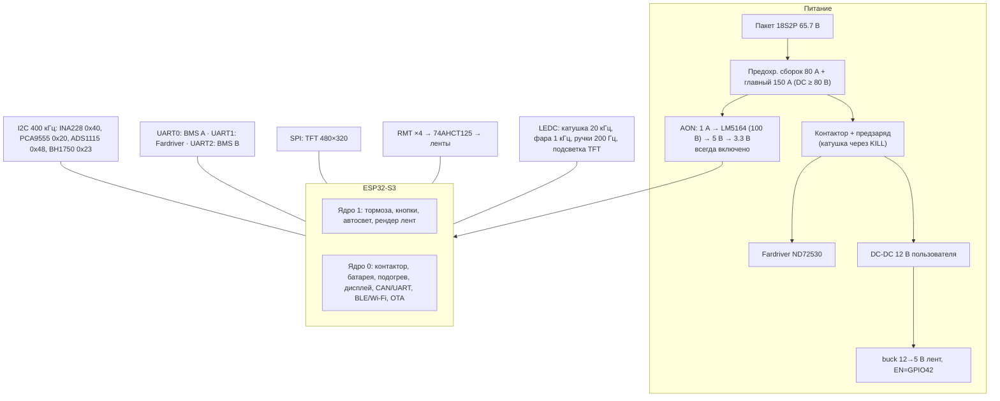

# Архитектура

## 1. Цели и ограничения

- Один контроллер **ESP32-S3** на всю «умную» электрику велосипеда (свет, сигналы, батарея, телеметрия).
- **Безопасность сигналов важнее эффектов:** стоп и поворотники считаются первыми, мигают синхронно на всех лентах, при сбое — fail-safe.
- Батарея **18S2P**: 2 сборки × 50 А·ч, 65.7 В полный / 57.6 В номинал, каждая со своим **JBD BMS**. Химия — **LiFePO4 (допущение, подтвердить)**, т. к. 3.65 В/ячейку.
- Модули разрабатываются параллельно разными людьми/агентами: общая точка соприкосновения — структура `VehicleState` и карта выводов.

## 2. Выбор фреймворка: Arduino + PlatformIO (FastLED)

| Критерий | Arduino (arduino-esp32) + PlatformIO | Чистый ESP-IDF |
|---|---|---|
| FreeRTOS | доступен напрямую (`xTaskCreatePinnedToCore`), Arduino — тонкая обёртка над IDF | нативно |
| Адресные ленты | **FastLED** / NeoPixelBus — зрелые, RMT-драйвер, богатые эффекты (`fill_solid`, `beatsin8`, палитры) | `led_strip` из IDF, эффекты писать самим |
| Датчики (INA228, BH1750, VEML7700, OLED) | готовые библиотеки и `Wire` | придётся портировать |
| BLE / Wi‑Fi / OTA / NVS | NimBLE-Arduino, `ArduinoOTA`, `Update`, `Preferences` | есть, но больше кода |
| Порог входа для контрибьюторов | низкий | выше |
| Доступ к IDF при необходимости | да: `driver/twai.h`, `esp_*` API вызываются из Arduino-кода | — |

**Решение:** Arduino-фреймворк в PlatformIO + **FastLED**. Причины: быстрее прототипирование эффектов,
привычная экосистема для участников, при этом низкоуровневые вещи (TWAI/CAN, RMT, watchdog) доступны через IDF API.
**NeoPixelBus** — запасной вариант, если FastLED на конкретной версии ядра даст мерцание при активном Wi‑Fi
(у NeoPixelBus есть DMA-методы I2S/RMT с другим поведением прерываний) — см. задачу LED-01.

Ограничение: ESP32-S3 имеет **4 канала RMT TX** → ровно 4 ленты (днище, зад, перед-L, перед-R). Для 5+ лент — объединять
ленты последовательно (одна линия данных) или перейти на I2S/LCD-параллельный драйвер.

## 3. Аппаратная архитектура



Карта выводов: [core/PINMAP.md](core/PINMAP.md). Питание: [../hardware/core.md](../hardware/core.md).

## 4. Программная архитектура

```mermaid
flowchart LR
  IN["inputs (5 мс)"] -->|brake, turn, switch| VS[("VehicleState<br/>мьютекс")]
  AL["auto_light (100 мс)"] -->|lux, mainLightOn| VS
  BM["battery_meter (100 мс, BMS 1 Гц)"] -->|BatteryData, packs[2]| VS
  CM["comms (10 мс)"] -->|speed, ошибки МК| VS
  BT["buttons (5 мс)"] -->|turn, lightSwitch, horn| VS
  BT -->|очередь UI| DSP["display (10 Гц)"]
  PW["power (10 мс)"] -->|loadOn| GR["grips (200 мс)"]
  VS -->|snapshot| DSP
  VS -->|snapshot| PW
  VS -->|snapshot| R["ledRender (60 кадр/с)<br/>rear → front → underglow → show()"]
  VS -->|snapshot| T["telemetry / BLE / OLED / лог"]
  VS -->|snapshot| BZ["buzzer"]
  VS -->|snapshot| OTA["ota (только на стоянке)"]
```

- **Шина данных — `VehicleState`** (`firmware/lib/core/vehicle_state.h`). Производители пишут поля под мьютексом через
  `vstate::modify()`, потребители работают с копией `vstate::snapshot()`. Каждое поле имеет одного владельца-писателя.
- **Синхронное мигание:** фаза считается из `turnSinceMs` (`vstate::blinkOn`), все ленты рисуются в одном кадре и
  выводятся одним `FastLED.show()`. Первая вспышка — сразу при включении поворота.
- **Приоритет сигналов** (сзади): аварийка = поворот > стоп > габарит. В сегменте поворота стоп не рисуется.

### Задачи FreeRTOS

| Задача | Ядро | Приоритет | Период | Стек | Владелец полей |
|---|---|---|---|---|---|
| `inputs` | 1 | 6 | 5 мс | 3 КБ | brake |
| `buttons` | 1 | 5 | 5 мс | 4 КБ | turn, turnSinceMs, lightSwitch, horn |
| `leds` | 1 | 5 | 16.7 мс | 4 КБ | — (только читает) |
| `autolight` | 1 | 4 | 100 мс | 3 КБ | ambientLux, mainLightOn |
| `buzzer` | 1 | 2 | 10 мс | 2 КБ | — |
| `power` | 0 | 5 | 10 мс | 4 КБ | (контактор, предзаряд; `power::loadOn()`) |
| `battery` | 0 | 4 | 100 мс | 6 КБ | battery.* |
| `grips` | 0 | 2 | 200 мс | 3 КБ | (уровни/температуры подогрева) |
| `display` | 0 | 2 | 100 мс | 8 КБ | tripKm, tripWh, tripSeconds |
| `comms` | 0 | 3 | 10 мс | 4 КБ | speedKmh, ошибки МК |
| `ota` | 0 | 1 | 50 мс | 4 КБ | — |
| `telemetry` | 0 | 1 | 1 с | 4 КБ | — |

Подробнее: [core/FREERTOS.md](core/FREERTOS.md).

## 5. Батарея: шунт + две BMS

- **Шунт + INA228** в общем минусе меряет **суммарный** ток обеих сборок (разряд, рекуперация, зарядка до 100 А) с
  высокой точностью и частотой; аппаратные накопители ENERGY/CHARGE исключают потерю заряда между опросами.
- **JBD BMS A и B** дают по каждой сборке: напряжение, ток, RSOC, остаток А·ч, циклы, 18 ячеек, NTC, флаги защит, состояние MOSFET.
- **Итоговый SoC** = кулон-счётчик по шунту + медленная подтяжка к средневзвешенному SoC BMS + синхронизация 100 % в конце заряда.
  Для LiFePO4 OCV-коррекция по напряжению только у краёв (кривая плоская).
- **Разбаланс сборок:** разница SoC > 10 % или доля тока одной сборки вне 50 % ± 30 % → флаг `packMismatch` → предупреждение.
- Деталь: [battery-meter/README.md](battery-meter/README.md).

## 5a. Силовая часть и питание

Три уровня питания: **пакет** → **AON** (всегда, для «мозга») → **12 В нагрузок** (после контактора). Включение ВВ — через
предзаряд и главный контактор под управлением ESP; kill-выключатель в цепи катушки. Подробно — [power/README.md](power/README.md),
[core/POWER.md](core/POWER.md).

## 5b. Интерфейс водителя

- Дисплей — слой `DisplayHal` (LVGL + LovyanGFX для ILI9488/ST7796S, заглушка в консоль), экраны в `screens.h` — [display/README.md](display/README.md).
- Кнопки — бэкенды PCA9555/ADC/GPIO, таблица назначений, события Short/Long/Repeat — [buttons/README.md](buttons/README.md).
- Тормоза **не** через модуль кнопок — прямые GPIO.

## 6. Конфигурация и OTA

- Константы сборки — `firmware/include/config.h`; изменяемые в работе — NVS (`config_store`), позже через BLE/веб.
- Разметка flash 16 МБ: `nvs`, `otadata`, 2 × 5 МБ приложение (A/B для OTA с откатом), ~6 МБ LittleFS под журналы.
- OTA разрешено только на стоянке: скорость < 0.5 км/ч, |ток| < 2 А.
- Окружения сборки: `esp32s3` (заглушка дисплея), `esp32s3_lvgl` (LVGL + LovyanGFX), `esp32s3_ota`, `native` (тесты).

## 7. Отказоустойчивость

- Task watchdog на `inputs` и `leds`; при перезагрузке первыми инициализируются ленты и выводится стоп/габарит.
- Kill-выключатель размыкает цепь катушки контактора аппаратно; прошивка лишь фиксирует событие (Fault).
- PCA9555 не отвечает → считается «kill нажат», контактор не включается.
- Предзаряд не дошёл до 92 % за 3 с → Fault (КЗ нагрузки), повтор только после снятия запроса.
- Подогрев: обрыв/КЗ NTC или > 55 °C → 0 %; SoC < 15 % → выкл.
- I2C делят задачи на двух ядрах — составные транзакции под рекурсивным мьютексом (`I2cLock`).
- Датчик освещённости недоступен → в AUTO свет включён.
- INA228 недоступен → ток/напряжение из BMS (грубее).
- BMS не отвечает > 5 с → сборка `offline`, предупреждение.
- Предложение (REAR-05): аппаратный резерв стоп-сигнала — сигнал тормоза через диод/МОП на отдельную красную секцию, независимо от ESP.

## 8. Ветки

- `main` — контроллер и модули 1–9.
- `charger-gbt` — быстрая зарядка GB/T DC (отдельный исполнитель). В `main` — только [charger/README.md](../charger/README.md).
