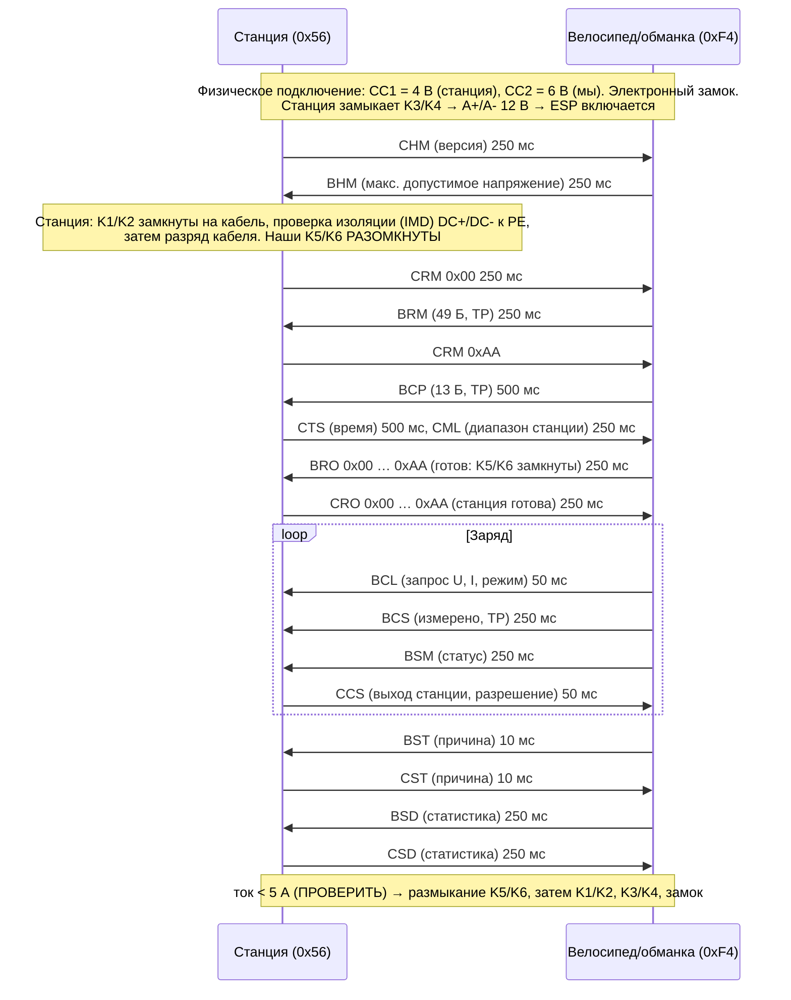

# Протокол GB/T 27930 (класс A) и физическое подключение GB/T 18487.1

Наше устройство на шине — **транспортное средство (BMS/EVCC)**. Станция — «зарядное устройство» (charger).
Этот протокол уже реализует обманка FGMDCharge (`main/sm_relay.c`, `main/can_gbt.c`); здесь — справка
и то, что меняет быстрая зарядка.

> Обозначения: **ПРОВЕРИТЬ** — значение взято из открытых описаний/кода обманки, но не сверено с текстом стандарта
> (официальный текст GB/T 27930-2015 платный). Перед использованием сверить.

## 1. Версии

| Версия | Как обманка определяет (`app_state_can_rx()`) | Статус в fastcharge |
|---|---|---|
| GB/T 27930-2011 | CRM без CHM | поддерживается заполнением тех же полей (BRM 41 байт, CCS/CML 6 байт) |
| GB/T 27930-2015 (и 2023 класс A) | CHM `0x1826F456`, версия `01 01 00` | **основная цель** |
| GB/T 27930-2023 класс B (ChaoJi-совместимый) | кадр версии `(id & 0xFFFFFF) == 0x0038255F` | **не поддерживается** быстрой зарядкой (только обманка, `gbt_b.c`) |

## 2. Физический уровень

- CAN 2.0B, **250 кбит/с**, 29-битные идентификаторы, порядок байт little-endian (J1939-подобный).
- Адреса: зарядное устройство **0x56**, BMS **0xF4**. ID = приоритет(3) | R | DP | PF | PS (получатель) | SA (отправитель).
- Линии S+ (CAN-H) / S- (CAN-L) в разъёме. Терминатор: **ПРОВЕРИТЬ** мультиметром с подключённым
  пистолетом (при двух терминаторах ~60 Ом между S+ и S-).
- Многопакетные сообщения (BRM 49 Б, BCP 13 Б, BCS 9 Б) — транспорт SAE J1939-21:
  TP.CM `PF=0xEC`, TP.DT `PF=0xEB`, приоритет 7 (в 2011 обманка использует приоритет 6).
  Стандартный режим — **RTS/CTS** (0x10 → 0x11 → DT… → 0x13). Обманка шлёт **BAM-подобно** (0x20, без ожидания CTS)
  и сообщает, что это работает на её станциях; в заводском дампе видны 0x11/0x13. Модуль `gbt_tp_tx.c`
  реализует оба режима (**ПРОВЕРИТЬ** на станциях, задача GBT-4).
- Единицы: напряжение 0,1 В/бит, смещение 0; **ток 0,1 А/бит, смещение −400 А, ток заряда отрицательный**
  (raw = 4000 − |I|×10). Температура 1 °C/бит, смещение −50 °C. SOC в BCP — 0,1 %/бит (2 байта), в BCS — 1 %.

## 3. Последовательность сессии

## 4. Сообщения

Направление: **B→C** — шлём мы, **C→B** — шлёт станция. ID — как в `gbt_codec.h` (совпадают с `can_gbt.h` обманки).

| Сообщ. | PGN (hex) | ID | Пр. | Длина | Период | Содержимое (2015) | Откуда данные (ревизия 2: кубик ← REQUEST контроллера) |
|---|---|---|---|---|---|---|---|
| CHM C→B | 0x2600 | 0x1826F456 | 6 | 3 | 250 мс | версия протокола | — |
| BHM B→C | 0x2700 | 0x182756F4 | 6 | 2 | 250 мс | макс. допустимое суммарное напряжение заряда | **275 В** (`REQUEST.bhm_vmax`, предел входа блоков; без связи — 450 В как в кубике) |
| CRM C→B | 0x0100 | 0x1801F456 | 6 | 8 | 250 мс | результат 0x00/0xAA, номер станции (4), код региона (3) | — |
| BRM B→C | 0x0200 | TP | 7 | 49 (2011: 41) | 250 мс | версия(3), тип батареи(1), ёмкость 0,1 Ач, напряжение 0,1 В, производитель, № пакета, дата, циклы, VIN(17), версия ПО BMS | тип 0x03 LFP (**ПРОВЕРИТЬ** таблицу типов), кубик: как сейчас (400 В/100 Ач); **ПРОВЕРИТЬ**, не смущает ли станции номинал 400 В при max 275 В — можно 250 В |
| BCP B→C | 0x0600 | TP | 7 | 13 | 500 мс | макс. U ячейки 0,01 В; макс. ток; энергия 0,1 кВт·ч; макс. суммарное U; макс. T; SOC 0,1 %; текущее U батареи | реальный SOC; **max U = 275 В**; текущее U = U запроса (250 В) — см. п. 6 |
| CTS C→B | 0x0700 | 0x1807F456 | 6 | 7 | 500 мс | время BCD | — |
| CML C→B | 0x0800 | 0x1808F456 | 6 | 8 (2011: 6) | 250 мс | макс./мин. U выхода, макс./мин. I | → STATION.cml_* → контроллер проверяет min ≤ 270 В |
| BRO B→C | 0x0900 | 0x100956F4 | 4 | 1 | 250 мс | 0x00 не готов / 0xAA готов | **0xAA только при свежем REQUEST.READY** |
| CRO C→B | 0x0A00 | 0x100AF456 | 4 | 1 | 250 мс | 0x00 / 0xAA | — |
| BCL B→C | 0x1000 | 0x181056F4 | 6 | 5 | 50 мс | запрос U, запрос I, режим (0x01 CV, 0x02 CC) | REQUEST.bcl_*: 250 В, I = P/0,9/U × 1,15 + 1 А (≥ 1 А, чтобы станция дала напряжение) |
| BCS B→C | 0x1100 | TP | 7 | 9 | 250 мс | измерено U, I; макс. U ячейки (12 бит) + № группы (4 бита); SOC %; оставшееся время, мин | REQUEST.bcs_*: реальное U станции (от Flatpack) и ток, который берём; SOC реальный |
| CCS C→B | 0x1200 | 0x1812F456 | 6 | 8 (2011: 6) | 50 мс | выход U, I, время заряда, бит разрешения (01 разрешено, 00 пауза) | → STATION.ccs_* и флаг permit |
| BSM B→C | 0x1300 | 0x181356F4 | 6 | 7 | 250 мс | № ячейки с макс. U, макс./мин. T и номера, биты состояния: U ячейки, SOC, перегрузка по току, перегрев, изоляция, разъём, **разрешение заряда** | REQUEST: реальные температуры/ячейка; «заряд разрешён» = ALLOW и связь свежая |
| BMV/BMT/BSP B→C | 0x1500/0x1600/0x1700 | TP | 7 | перем. | 10 с | напряжения ячеек / температуры / резерв (опционально) | TODO: реальные 18×2 ячейки |
| BST B→C | 0x1900 | 0x101956F4 | 4 | 4 | 10 мс | причина остановки, коды неисправностей, ошибки | REQUEST.STOP + bst_* или потеря связи |
| CST C→B | 0x1A00 | 0x101AF456 | 4 | 4 | 10 мс | причина остановки станции | → завершение |
| BSD B→C | 0x1C00 | 0x181C56F4 | 6 | 7 | 250 мс | SOC, мин./макс. U ячейки, мин./макс. T | кубик (пока константы, CUBE-9) |
| CSD C→B | 0x1D00 | 0x181DF456 | 6 | 8 | 250 мс | время, энергия 0,1 кВт·ч, № станции | — |
| BEM B→C | 0x1E00 | 0x081E56F4 | 2 | 4 | 250 мс | таймауты приёма CRM/CML/CRO/CCS/CST/CSD (поля по 2 бита) | обманка, без изменений |
| CEM C→B | 0x1F00 | 0x081FF456 | 2 | 4 | 250 мс | таймауты приёма станцией BRM/BCP/BRO/BCS/BCL/BST/BSD | лог + стоп |

Раскладка битов BSM (байты 6–7), BST/CST, BEM/CEM — в `gbt_codec.h`; байт 7 BSM в норме `0xD0`
совпадает с обманкой. Порядок битов неисправностей BST — **ПРОВЕРИТЬ**.

## 5. Тайм-ауты (**ПРОВЕРИТЬ** по тексту GB/T 27930-2015, таблица периодов/тайм-аутов)

| Кто ждёт | Чего | Обычно указывают | В обманке сейчас |
|---|---|---|---|
| BMS | CRM 0x00 / 0xAA | 5 с | 30 с на всё состояние `ST_WAIT_CRM` |
| BMS | CML (после BCP) | 5 с | 20 с `ST_PARAM_CONFIG` |
| BMS | CRO 0xAA | 5 с (готовность 60 с) | 30 с `ST_READY_WAIT_CRO` |
| BMS | CCS | 1 с | общий «CAN молчит 3 с» |
| BMS | CST после BST | 5 с | не ждёт |
| BMS | CSD | 10 с | не ждёт |
| Станция | BRM / BCP / BRO | 5 с (BRO 0xAA — 60 с) | — |
| Станция | **BCL** | **1 с** | BCL каждые 50 мс |
| Станция | BCS | 5 с | 250 мс |
| Станция | BST / BSD | 5 с / 10 с | — |

При тайм-ауте сторона шлёт BEM/CEM и (в 2015) делает до 3 попыток повторного установления связи (**ПРОВЕРИТЬ**).

## 6. Важная особенность: «виртуальная» высоковольтная батарея

Станция думает, что заряжает батарею ~250 В (ревизия 2; было 400 В). Поэтому **всё, что относится к суммарному напряжению/току** (BHM, BRM номинал,
BCP макс. и текущее U, BCL, BCS U/I), — это величины ВВ-стороны (вход блоков питания). Реальные — только SOC, ячейки и температуры.

**Открытый вопрос (риск №1):** по GB/T 18487.1 (приложение B) после BRO=0xAA станция может сравнивать
напряжение за K5/K6 с «текущим напряжением батареи» из BCP (допуск обычно ±5 %, **ПРОВЕРИТЬ**). У нас за
K5/K6 — входы блоков питания (0 В, их входные конденсаторы за схемой ограничения пускового тока).
Кубик при этом уже работает на реальных станциях (реле B замыкается после 3 с стабильного U CCS), т. е. его станции
эту проверку не делают или терпят. Проверить логами (TEST-3); если не проходит — отдельная задача.

## 7. Подключение: CC1, CC2, A+/A- (GB/T 18487.1-2015, приложение B)

Контакты разъёма: DC+, DC-, PE, S+, S-, CC1, CC2, A+, A-.

| Цепь | Где | Номинал | Состояния |
|---|---|---|---|
| CC1 (детектор 1, в станции) | R1 = 1 кОм к U1 = 12 В в станции; R2 = 1 кОм в вилке через кнопку S; **R4 = 1 кОм CC1–PE в автомобильной розетке** | 1 кОм | 6 В — вилка на станции/вставлена с нажатой кнопкой; 12 В — кнопка нажата, не вставлена; **4 В — полностью вставлена** |
| CC2 (детектор 2, у нас) | R5 = 1 кОм к U2 = 12 В на нашей стороне; R3 = 1 кОм CC2–PE в вилке | 1 кОм | 12 В — вилки нет; **6 В — подключено** |
| A+/A- | 12 В ±5 %, до 10 А от станции через K3/K4 | — | появляется после подтверждения подключения; питаем от него ESP, драйверы, катушки |

Значит, на стороне велосипеда нужны **R4 = 1 кОм между CC1 и PE** и **R5 = 1 кОм подтяжка CC2 к 12 В** + измерение CC2.
Источник U2: если брать от A+, то CC2 «появляется» только после K3/K4 — в публикациях есть разночтения
о моменте 12→6 В на детекторе 2 (**ПРОВЕРИТЬ**). Предлагаем U2 от собственного 12 В велосипеда (DC-DC от батареи),
а питание логики — от A+ (задача HW-3). Допуски уровней — **ПРОВЕРИТЬ** (в коде окно 4,8–7,2 В).
Есть ли R4 в «кубике» обманки — **ПРОВЕРИТЬ** (без него станция не увидит 4 В).

## 8. Временная диаграмма (ревизия 2)

| Этап | Станция | Кубик | Контроллер |
|---|---|---|---|
| T0–T1 | CC1 6 → 4 В, замок | (CC2 — как сейчас) | работает от батареи, связь IDLE |
| T2 | K3/K4 → A+ 12 В | старт ~0,4 с | связь появляется: ARMED |
| T3 | CHM, проверка изоляции | BHM (max 275 В) | читает JBD |
| T4 | CRM / CML | BRM / BCP | окно CML ≤ 270 В? → READY |
| T5 | — | BRO 0xAA при READY, реле A | PERMIT |
| T6 | K1/K2, CRO 0xAA, CCS | реле B после 3 с стабильного U | Vin → PS_ON → MATCH → K-BAT |
| T7 | CCS | BCL/BCS/BSM из REQUEST | CC → CV |
| T8 | CST (или наш BST) | BST → BSD → реле выкл. | ток → 0 → K-BAT, PERMIT ↓ |
