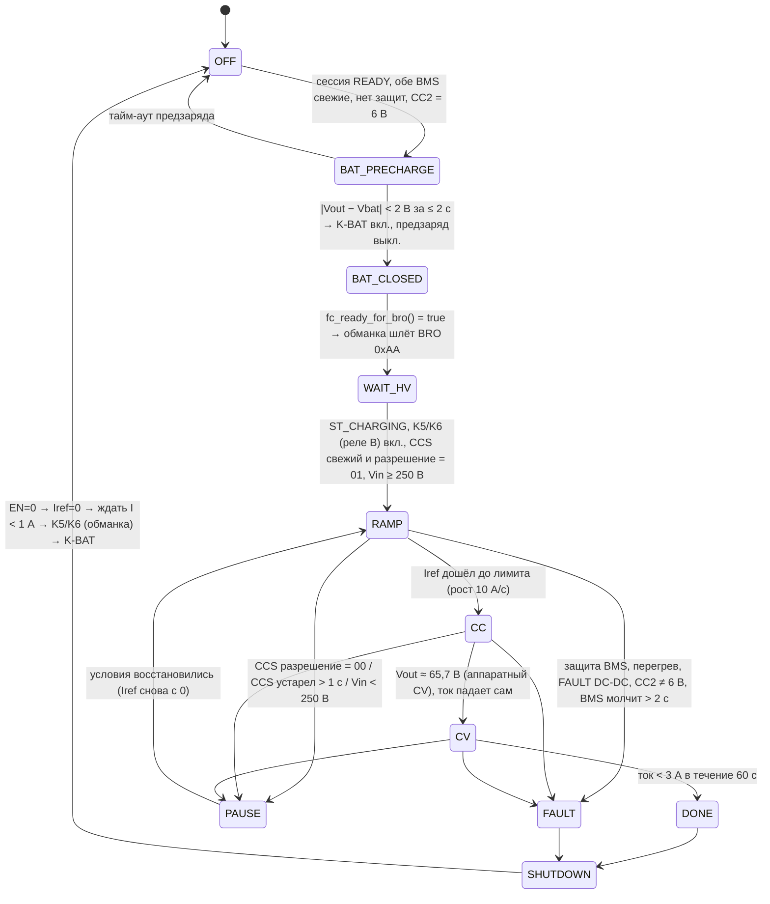

# Машины состояний

Два уровня:
1. **Сессия GB/T** — уже есть в обманке (`sm_relay.c`, состояния 0…7 из `app_state.h`). Мы её не переписываем,
   а добавляем условия (жёлтые пометки «FC:»).
2. **Силовой путь fastcharge** — внутри компонента (`fc_core.c`, `fc_task.c`, `fc_supervisor.c`).

## 1. Сессия (обманка + хуки fastcharge)

```mermaid
stateDiagram-v2
    [*] --> ST_IDLE
    ST_IDLE --> ST_HANDSHAKE_INIT: CAN от станции (авто) / sm_start_session()<br/>FC: fc_on_session_state(HANDSHAKE)
    ST_HANDSHAKE_INIT --> ST_WAIT_CRM
    ST_WAIT_CRM --> ST_PARAM_CONFIG: CRM 0xAA (BHM/BRM отправлены)<br/>FC: BHM/BRM из fc_fill_bhm()/fc_fill_brm()
    ST_WAIT_CRM --> ST_IDLE: 30 с без CRM → BEM
    ST_PARAM_CONFIG --> ST_READY_WAIT_CRO: CML получен (BCP отправлен)<br/>FC: BCP из fc_fill_bcp();<br/>FC: если CML вне окна DC-DC → BST, стоп
    ST_PARAM_CONFIG --> ST_IDLE: 20 с без CML → BEM
    ST_READY_WAIT_CRO --> ST_CHARGING: CRO 0xAA<br/>FC: BRO=0xAA только при fc_ready_for_bro()
    ST_READY_WAIT_CRO --> ST_IDLE: 30 с без CRO → BEM
    ST_CHARGING --> ST_STOP: CST / CEM / CSD / пользователь / CAN молчит 3 с<br/>FC: fc_stop_requested() → BST с причиной
    ST_STOP --> ST_FINALIZE: FC (TODO обманки): BST каждые 10 мс до CST, BSD до CSD, ток < 5 А
    ST_FINALIZE --> ST_IDLE: реле A/B выкл.
```

Реле обманки в режиме быстрой зарядки:
- **ST_READY_WAIT_CRO (вход):** реле A (GPIO6) — предзаряд ВВ-входа DC-DC.
- **ST_CHARGING:** когда напряжение CCS ≥ 50 В стабильно 3 с — реле B (GPIO7) = K5/K6, реле A выкл. (существующая логика `s_load_on`/`s_handoff`).
  Изменить: порог CCS ≥ `FC_DCDC_VIN_MIN` (250 В), а не 50 В.
- **IDLE/STOP/FINALIZE:** оба выкл. В режиме быстрой зарядки **отключить** ручное «удержание нагрузки» (`sm_request_relay_test`)
  и BLE-команду 0x66 — это прямое управление ВВ-контактором.

## 2. Силовой путь (fastcharge)

Порядок выключения всегда: **DC-DC EN = 0 → ток = 0 → контакторы**. Никогда не размыкать контактор под током.

## 3. Соответствие кода

| Состояние | Где в коде |
|---|---|
| OFF / BAT_PRECHARGE / BAT_CLOSED | `fc_task()` — `want_k`, `fc_precharge_set()`, `fc_batt_contactor_set()` |
| WAIT_HV / RAMP / CC / CV / PAUSE | `fc_supervisor_step()` — `power_path_ready`, ограничение скорости роста `iref_0p1a`, аппаратный CV через `vref_0p1v` |
| DONE / FAULT | `fc_supervisor_t.stop` (защёлка) → `fc_stop_requested()` → BST |
