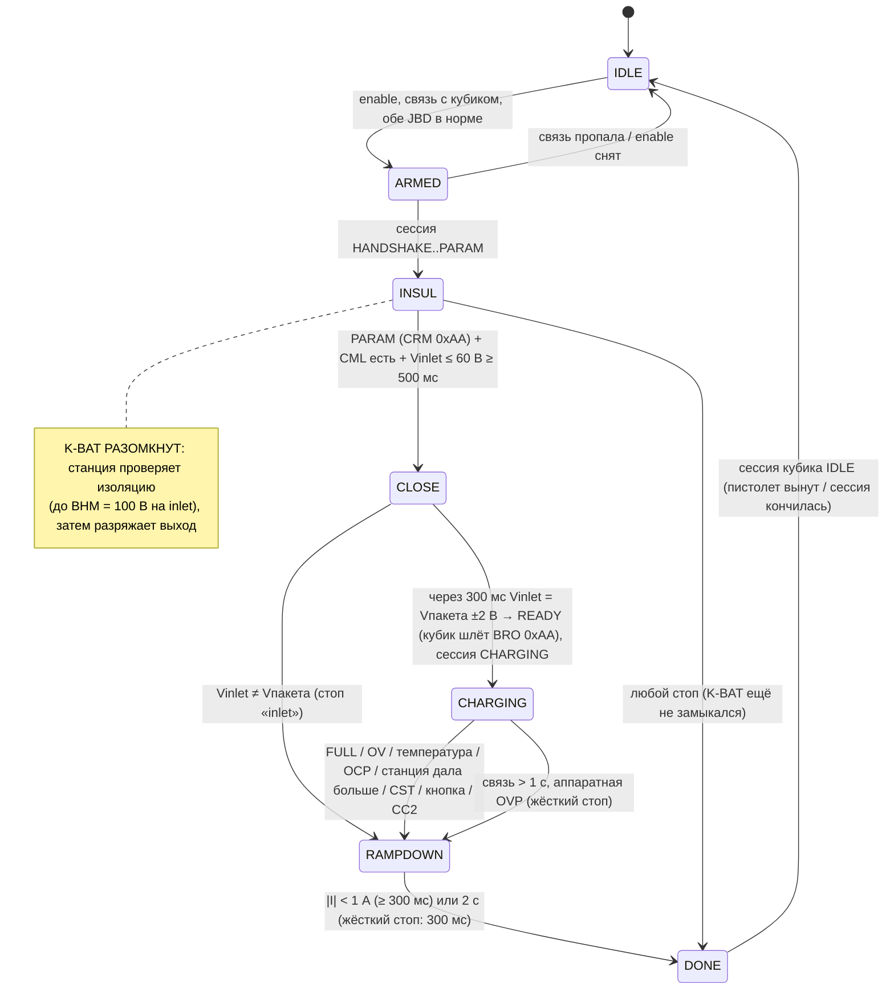
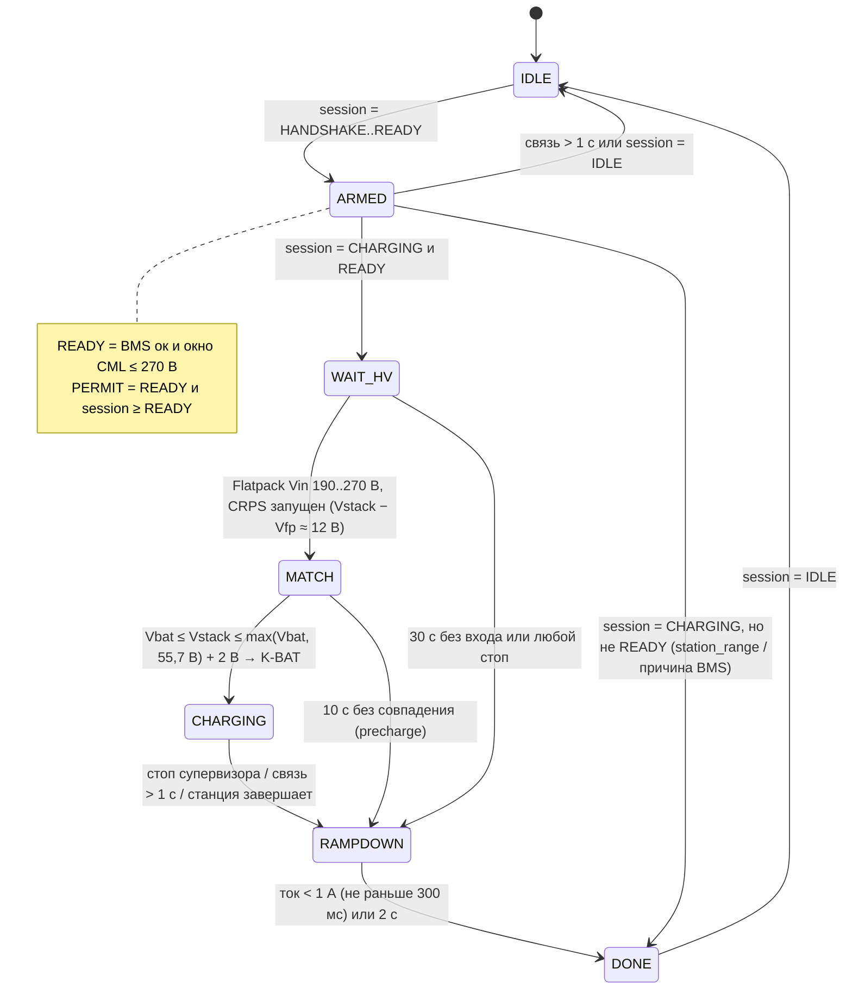

# Машины состояний

Ревизия 3: две независимые машины на двух платах, связанные только протоколом FCL v2 (ESP-NOW).
Основной режим контроллера — **прямой** (`direct_core.c`, раздел 0). Раздел 2 — DC-DC вариант
(`charger_core.c`, приложение). Кубик (раздел 1) одинаков для обоих; в прямом режиме BHM/BCP max = **100 В**
(а не 275 В) и BCP заполняется из REQUEST (правки 15–17, INTEGRATION §5).

## 0. Контроллер, прямой режим (`direct_core_step`, 10 Гц)



| Состояние | K-BAT | PERMIT | REQUEST.flags | BCL I |
|---|---|---|---|---|
| IDLE | 0 | 0 | DIRECT | 0 |
| ARMED / INSUL | 0 | 1 | DIRECT, HV_PERMIT | 0 |
| CLOSE | **1** | 1 | + READY (после проверки 300 мс) | 0 |
| CHARGING | 1 | 1 | READY, ALLOW | регулятор: рампа 10 А/с, лимиты JBD, своё CV |
| RAMPDOWN | 1 (до \|I\| < 1 А) | 0 | STOP + BST-причина | 0 |
| DONE | 0 | 0 | STOP | 0 |

BCL U всегда = max(65,7 В, CML min) ≤ BCP max (100 В); если CML min > 100 В — стоп «station_range»
до замыкания K-BAT. Аппаратная OVP снимает K-BAT в том же цикле, без ожидания тока.

## 1. Кубик (FGMDCharge `sm_relay.c`) — что меняется

Логика кубика остаётся, добавлены только условия (выделены **жирным**, номера правок — INTEGRATION §5).

```mermaid
stateDiagram-v2
    [*] --> IDLE
    IDLE --> HANDSHAKE_INIT: старт / станция на CAN
    HANDSHAKE_INIT --> WAIT_CRM
    WAIT_CRM --> PARAM_CONFIG: CRM 0xAA (BHM max = 275 В — правка 4)
    PARAM_CONFIG --> READY_WAIT_CRO: CML получен (BCP max = 275 В)
    READY_WAIT_CRO --> CHARGING: CRO 0xAA
    note right of READY_WAIT_CRO
      BRO 0x00 первые 2 с,
      затем 0xAA ТОЛЬКО если REQUEST.READY свежий (правка 5)
    end note
    CHARGING --> STOP: CST / CEM / тишина CAN 3 с / кнопка
    CHARGING --> STOP: REQUEST.STOP или связь > 1 с (правка 9) → BST с причиной
    READY_WAIT_CRO --> STOP: REQUEST.STOP (правка 10)
    STOP --> FINALIZE --> IDLE
```

В `CHARGING` каждые 10 мс `fc_cube_link_tick()`: шлёт STATION раз в 100 мс; свежий REQUEST →
`app_state_set_bcl / set_battery_vi / set_soc` → существующие `tx_bcl/tx_bcs` отправляют реальные запросы;
REQUEST старше 300 мс → BCL I = 0 и BSM «не разрешено».

## 2. Контроллер зарядки (`charger_core.c`)



| Состояние | K-BAT | PERMIT | CRPS | Flatpack U / I | REQUEST |
|---|---|---|---|---|---|
| IDLE | 0 | 0 | 0 | — | READY 0 |
| ARMED | 0 | READY ∧ session ≥ READY | 0 | — | READY по проверкам, BCL I = 0 |
| WAIT_HV | 0 | 1 | 1, как только есть Vin | 43,5 В / 2 А | ALLOW, BCL I = минимум (1 А + 15 %) |
| MATCH | 0 → 1 | 1 | 1 | Vbat − Vcrps / 2 А | ALLOW |
| CHARGING | 1 | 1 | 1 | 65,7 − Vcrps / Iref ÷ нитки | ALLOW, BCL I = (P / 0,9 / U) × 1,15 + 1 А |
| RAMPDOWN | 1 → 0 | 1 → 0 | 1 → 0 | 43,5 В / 0 | STOP + причина |
| DONE | 0 | 0 | 0 | — | STOP |

## 3. Супервизор тока (внутри CHARGING, `fc_supervisor.c`)

1. Для каждой JBD: протухла > 2 с → стоп `bms_lost`; флаг защиты / выключен MOSFET заряда → `bms_fault`;
   ячейка ≥ 3,70 В → `cell_ov`; температура вне 0…55 °C → `temp`.
2. Лимит пакета: 50 А × коэффициент температуры (20 / 50 / 100 / 50 / 20 %) × сужение по ячейке 3,55 → 3,65 В;
   ячейка < 2,5 В → 5 А.
3. Общий лимит с учётом неравного деления тока между параллельными пакетами.
4. Ограничение блоков: min(37 А × ниток, мощность Flatpack при текущем U); Flatpack горячее 60 °C → половина.
5. Связь > 300 мс → цель 0 А (пауза), > 1 с → стоп `link_lost`.
6. Рост ≤ 10 А/с, снижение мгновенно. Конец: U ≥ 65,4 В и ток < 3 А 60 с → `full`.

## 4. Отказы (кто что делает)

| Событие | Контроллер | Кубик | Железо |
|---|---|---|---|
| Пропало радио | 300 мс: 0 А; 1 с: K-BAT, PERMIT ↓ | 300 мс: BCL 0 А; 1 с: BST, реле ↓ | K5/K6 отпадают от PERMIT |
| Завис контроллер | — | REQUEST пропал → как выше | драйверы K-BAT/PERMIT отпускают за ~50 мс; Flatpack через 15 с → 43,5 В |
| Завис кубик | STATION пропал → как выше | — | станция: нет BCL 1 с → стоп |
| Выдернули разъём | Vin пропал / связь | A+ пропал, кубик обесточен | K5/K6 без питания катушек |
| Станция подняла U > 275 В | Vin от Flatpack > 275 В → стоп `station_range`, ток 0, K-BAT ↓ | BST | Flatpack отключается > 300 В; предохранители |
