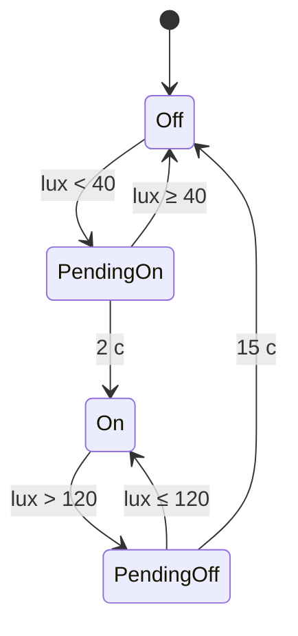

# Модуль 6. Автоматический свет

## Входы
- **Датчик освещённости** (I2C): BH1750 `0x23` (по умолчанию) или VEML7700 `0x10` (лучше в темноте и на ярком солнце); бюджетно — фоторезистор на GPIO2 (ADC).
  Устанавливать на верхней поверхности, за матовым окном, **не в зоне засветки собственной фарой и лентами**.
- **Переключатель света** — 3 положения: `OFF` / `AUTO` / `ON` — через модуль кнопок руля (`lib/buttons`): два контакта типа Level (`LightAuto`, `LightOn`; оба разомкнуты = OFF) или одна кнопка `LightCycle`.

## Логика (`auto_light_logic.h`, чистый C++, покрыта тестами)
| Положение | Свет |
|---|---|
| OFF | выключен всегда |
| ON | включён всегда |
| AUTO | по освещённости с гистерезисом |

Гистерезис AUTO:
- **порог:** включение при lux < `CFG_AUTO_LUX_ON` (40), выключение при lux > `CFG_AUTO_LUX_OFF` (120);
- **время:** включение через 2 с (тоннель — быстро), выключение через 15 с (тени, фонари — медленно);
- сглаживание: экспоненциальный фильтр α = 0.2 при опросе 100 мс;
- **fail-safe:** нет датчика / ошибка I2C → в AUTO свет включён.

## Выходы
- `mainLightOn` в `VehicleState` → фара (LEDC PWM GPIO41), задний габарит, передний габарит, режим днища Follow.
- Фара: N-MOSFET logic-level ≥ 100 В или управляющий вход фары/контроллера мотора (уточнить, как питается фара).
- Планы: плавное включение (AL-04), ДХО днём (≈30 %), дальний/ближний.

## Задачи
`AL-01 … AL-05` в [../TASKS.md](../TASKS.md). Код: `firmware/lib/auto_light/`.
