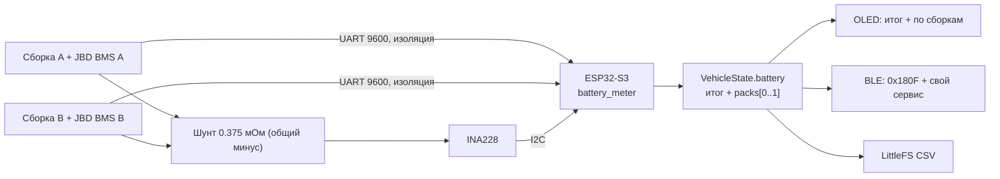

# Модуль 2. Счётчик заряда/разряда батареи

## Исходные данные (от пользователя)
| Параметр | Значение |
|---|---|
| Конфигурация | **18S2P** — две сборки 18S по **50 А·ч** параллельно, итого **100 А·ч** |
| Напряжение | полный **65.7 В** (3.65 В/яч.), номинал ~**57.6 В** (3.2 В/яч.) |
| Химия | **LiFePO4 — допущение по 3.65 В/яч., подтвердить** |
| BMS | у каждой сборки свой **JBD** (UART/BLE, протокол Xiaoxiang) |
| Энергия | ≈ 5.76 кВт·ч |
| Зарядка | быстрая до 100 А — в ветке `charger-gbt`; ток проходит через общий шунт |

## Состав

## Предохранители и распределение тока
- Каждая сборка — свой предохранитель 80 А (DC ≥ 80 В) у клеммы; общий — 150 А. См. [../power/README.md](../power/README.md).
- Ток делится между сборками неравномерно; лимит Fardriver 100 А длит. / 120 А пик при 2 × JBD 60/70 А. Флаг `packMismatch` → предупреждение на дисплее.

## Шунт и INA228
- **INA228**: шина до 85 В (подходит для 65.7 В), 20-битный АЦП, аппаратные накопители энергии и заряда. **INA226 не подходит** (шина до 36 В).
- **Шунт 75 мВ / 200 А = 0.375 мОм**, режим ADCRANGE=1 (±40.96 мВ) → полный диапазон ≈ **109 А**: покрывает 100 А быстрой зарядки и типичные пики мотора. Если пиковый ток мотора > 100 А — ADCRANGE=0 (±163.84 мВ, ~437 А, разрешение хуже) — уточнить у пользователя.
- Рассеяние на шунте при 100 А: 100² × 0.375 мОм = **3.75 Вт** — шунт на радиаторе/корпусе, проводники ≥ 16 мм².
- `CURRENT_LSB = Imax / 2^19`, `SHUNT_CAL = 13107.2·10⁶ × CURRENT_LSB × Rшунта × 4` (для ADCRANGE=1).
- Калибровка (BAT-02): по эталонному амперметру при 5/20/50 А — коэффициент в NVS.

## JBD BMS
- UART 9600 8N1, 3.3 В. Запрос `DD A5 03 00 FF FD 77` — базовая информация, `DD A5 04 00 FF FC 77` — ячейки.
- Из ответа 0x03: напряжение (10 мВ), ток (10 мА, **+ = заряд**, в прошивке знак инвертируется), остаток/номинал (10 мА·ч), циклы, флаги защит, **RSOC %**, состояние MOSFET, число ячеек, NTC (0.1 K).
- Из ответа 0x04: 18 напряжений ячеек (мВ) → мин/макс/дельта.
- Опрос поочерёдно: A и B, каждый раз в секунду. Нет ответа > 5 с → `online=false`.
- **Гальваническая развязка обязательна** (ISO7721/ADuM1201 + изолированное питание 3.3 В со стороны BMS или питание от вывода BMS): земля BMS — B−, земля контроллера — P−; при срабатывании защиты BMS потенциалы расходятся на полное напряжение сборки.
- Альтернатива UART — BLE JBD (сервис `FF00`, характеристики `FF01` notify / `FF02` write, тот же формат кадров) — задача BAT-09; ESP32-S3 как BLE-central к двум BMS. UART надёжнее и не грузит радио.

## Объединение данных
| Величина | Источник |
|---|---|
| Суммарные V, I, P, Вт·ч, А·ч | INA228 (резерв — сумма BMS) |
| Итоговый SoC | `SocEstimator`: кулон-счётчик по шунту + подтяжка к средневзвешенному RSOC BMS (50 %/ч) + синхронизация 100 % при V ≥ 18 × 3.60 В и токе заряда < C/50 (2 А) в течение 3 с |
| SoC, ток, ячейки, температуры, защиты по сборке | JBD BMS A / B |
| Разбаланс сборок | ΔSoC > 10 % или доля тока сборки вне 50 % ± 30 % при |I| > 5 А |

Для LiFePO4 OCV плоская (≈3.25–3.33 В на 20–80 %) — по напряжению SoC не уточняется, только по краям.

## Вывод
- **OLED** (BAT-06): страница «Итог» (V, I, P, SoC, остаток А·ч, Вт·ч/км), страница «Сборки» (A/B: SoC, I, ΔV ячеек, T, флаги).
- **BLE** (BAT-07): Battery Service `0x180F` (уровень = итоговый SoC) + собственный сервис телеметрии (JSON/CBOR-пакет 1 Гц: итог + packs[]).
- **Журнал** (BAT-08): LittleFS, CSV раз в 1 с во время езды/зарядки, кольцевой буфер ~5 МБ, выгрузка по Wi‑Fi.

## Сохранение состояния
SoC в NVS при изменении ≥ 1 % или раз в 5 мин. При старте — значение из NVS, иначе — первый ответ BMS.

## Задачи
`BAT-01 … BAT-09` в [../TASKS.md](../TASKS.md).
