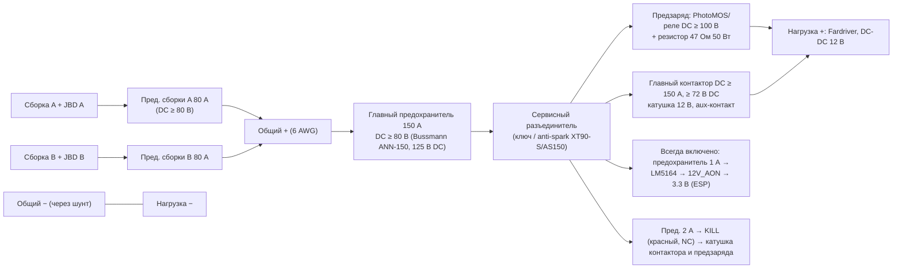

# Модуль 8. Главный контактор, предзаряд, аварийное отключение, сон «мозга»

## Задача
ESP32-S3 включает и выключает высоковольтную (ВВ) часть: контроллер мотора (**Fardriver ND72530**) и прочих ВВ-потребителей
(DC-DC 12 В пользователя). При этом сам ESP («мозг») питается **всегда** от отдельного маломощного источника с малым током покоя.

## Исходные данные
| Параметр | Значение | Статус |
|---|---|---|
| Пакет | 18S2P, 65.7 В макс / 57.6 В ном / ~50 В мин | от пользователя |
| Контроллер сейчас | ~80 А длительно | от пользователя |
| Контроллер план | **Fardriver ND72530**: 48/60/72 В, макс. 88 В; DC пик 350 А (≈330 А длит. по данным продавцов), фаза пик 530 А, 24 MOSFET, IP67 | по открытым описаниям — **проверить на своём экземпляре** |
| Ограничение пользователя | **100 А длительно / 120 А пик** по батарее | защита двух JBD (60 А длит. / 70 А пик каждый = 120/140 А) |
| Силовой провод | **6 AWG (~13.3 мм²)** | от пользователя |

## Структура силовой цепи

- Шунт INA228 — в общем минусе, учитывает и мотор, и электронику (см. [battery-meter](../battery-meter/README.md)).
- Мозг (AON) питается **до** контактора — включение/выключение и сон работают без ВВ на нагрузке.
- DC-DC 12 В пользователя и контроллер мотора — **после** контактора (без лишнего тока покоя на стоянке).

## Последовательность включения
| Шаг | Действие | Условие перехода | Ошибка |
|---|---|---|---|
| 0 | Проверки: kill не нажат, BMS разрешают разряд, aux контактора **разомкнут** | запрос «зажигания» | aux замкнут → «контакты сварены» |
| 1 | Включить предзаряд (реле P1.0) | V_load ≥ 92 % V_pack и прошло ≥ 200 мс | не достигли за 3 с → КЗ/неисправность нагрузки |
| 2 | Катушка: втягивание 150 мс (скважность = 12 В / V_pack) | aux замкнулся (≤ 200 мс после втягивания) | aux не замкнулся |
| 3 | Снять предзаряд, удержание катушки 35 % (экономайзер) | — | — |
| 4 | `loadOn = true` → шина 12 В, фара, ленты, подогрев | — | — |

Выключение: штатно — только при токе пакета < 10 А (попросить отпустить газ); снять ШИМ → aux разомкнулся ≤ 200 мс, иначе «контакты сварены».
Аварийно (kill, BMS) — немедленно, независимо от тока.

## Предзаряд для Fardriver
- Входная ёмкость ND72530 не опубликована; для оценки принято **≈ 5000 мкФ** (+ ёмкость DC-DC 12 В). [проверить: время предзаряда по осциллографу]
- R = **47 Ом, 50 Вт** (алюминиевый корпус, на радиатор): пиковый ток 65.7/47 ≈ 1.4 А, τ = R·C ≈ 0.24 с, 92 % за ~0.6 с.
- Энергия в резисторе за один предзаряд ≈ ½·C·V² ≈ 11 Дж — допустимо. При КЗ нагрузки мощность 92 Вт → **таймаут 3 с обязателен**.
- Ключ предзаряда: PhotoMOS/твердотельное реле **≥ 100 В DC, ≥ 2 А** или DC-реле с номиналом контактов ≥ 100 В DC (обычные реле «30 VDC» не подходят).
- Провод «зажигания» (ignition / electric lock) Fardriver — подключить к стороне нагрузки (после контактора), чтобы контроллер не пытался стартовать во время предзаряда.

## Главный контактор
- **DC-номинал** (дугогашение с магнитным дутьём, «sealed»), коммутируемое напряжение **≥ 72 В DC** (лучше 100–150 В), длительный ток **≥ 150 А**, катушка **12 В**, желательно **вспомогательный контакт**.
- Примеры класса: TE Kilovac EV200 (12–900 В DC, 500 А), Gigavac GX12/GX14, бюджетные «DC contactor 150–200 A, 72–120 V, coil 12 V» — у бюджетных проверять реальный DC-номинал и полярность.
- Если у контактора **встроенный экономайзер** (например, EV200 вариант HAA/HCA) — питать катушку чистыми 12 В, ШИМ не использовать (POWER-03).

### Драйвер катушки (без встроенного экономайзера)
```
Пакет+ ─[F 2 А]─[KILL NC]─┬─────────────► Катушка+ (и питание реле предзаряда)
                          │
                    D (100 В, быстр.) + TVS/стабилитрон 33 В последовательно — гашение (быстрое размыкание)
                          │
Катушка− ── Drain Q (N-MOSFET 100 В logic-level, IRL540N/аналог) ; Source ── GND
GPIO1 ─[100 Ом]─ Gate ; 10 кОм Gate→GND
```
- ШИМ 20 кГц, скважность втягивания = 12 В / V_pack (≈ 18–24 %), удержание — 35 % от неё (подбирается по даташиту: ток удержания ≈ 30–50 % тока втягивания).
- Только диод на катушке **замедляет размыкание** и усиливает дугу — поэтому диод + стабилитрон/TVS.
- Kill-выключатель стоит **в цепи питания катушки** → аппаратно размыкает контактор даже при зависшем ESP. Его второй контакт (или делитель) → PCA9555 P1.1, чтобы прошивка знала о нажатии.

## Предохранители и провода
| Место | Номинал | Тип |
|---|---|---|
| Каждая сборка (у клеммы сборки, ≤ 15–20 см) | **80 А** | DC ≥ 80 В (например, Bussmann ANN-80, заявлено 125 В DC — проверить по даташиту) |
| Главный (после объединения) | **150 А** | DC ≥ 80 В (ANN-150). ANL/MEGA/MIDI на 32 В **не подходят** по напряжению |
| Ветка AON (мозг) | 1 А | с DC-номиналом ≥ 80 В: SMD 125 В DC (Littelfuse 485/443-серии и т. п.) или 5×20 керамический с указанным DC-номиналом. Обычные автомобильные ATO/mini (32 В) **не подходят** |
| Ветка kill/катушка | 2 А | то же |
| Шина 12 В (после DC-DC) | по веткам: фара 5 А, подогрев 7.5 А, ленты 5 А | автомобильные ATO/ATC (12 В) |

- **Провод 6 AWG (13.3 мм²)** — пакет → предохранители → контактор → Fardriver; силикон, 200 °C. Допустимая нагрузка для коротких трасс ~100–120 А длительно — соответствует лимиту 100/120 А. Плюс и минус прокладывать рядом (минимальная петля → меньше выбросы на конденсаторах контроллера), трассы — **максимально короткие**.
- Перемычки сборок к общей шине — **одинаковой длины и сечения** (симметрия тока).
- **Наконечники:** медные лужёные под 6 AWG с нужным отверстием (M6/M8), обжим **шестигранным** (гидравлическим) инструментом под сечение, проверка на отрыв, термоусадка с клеем; пайка вместо обжима не допускается; затяжка по моменту клемм контактора/предохранителя, пружинные шайбы.

## Распределение тока между сборками и настройки Fardriver
- Две параллельные сборки делят ток **неравномерно** (внутреннее сопротивление, длина проводов, разный SoC): при 100 А реальное деление может быть 55/45…60/40 → одна BMS работает у предела 60 А.
- Рекомендации:
  - в Fardriver: **ток батареи (DC) ≤ 100 А**, пик ≤ 120 А, ток фазы — разумно ниже заводского (по мотору), **рекуперация** ≤ допустимого тока заряда BMS (уточнить, напр. ≤ 30 А суммарно);
  - **номинал/отсечка:** 18S LiFePO4 → выбирать пресет **60 В** или вручную задать отсечку ≈ 50 В (18 × 2.8 В) и максимум 66 В; у пресета 72 В отсечка 63 В — **выше номинала пакета, контроллер не поедет**;
  - предохранители на каждую сборку; контроль доли тока по данным JBD (`packMismatch`).
- Телеметрия Fardriver (скорость, ток, температура, ошибки) — по UART-порту адаптера Bluetooth / BLE; протокол закрытый, есть описания сообществом — **проверить** (задача CORE-04).

## Сон «мозга»
| Режим | Что включено | Ток от пакета (цель) |
|---|---|---|
| Езда | всё | — |
| Стоянка, ВВ выключено | ESP активен, Wi‑Fi/BLE по запросу | ≤ 30 мА |
| Light sleep (по таймеру) | ESP light-sleep, BLE-реклама редко | ≤ 5 мА |
| Deep sleep (10 мин после выключения) | только LM5164 + ESP RTC; пробуждение — сжатие ручки тормоза (GPIO14) | **≤ 0.5 мА** (без учёта BMS) |
Не уходить в сон во время зарядки (`charging`).

## Задачи
`PWR-01 … PWR-08` в [../TASKS.md](../TASKS.md). Схема: [../../hardware/power.md](../../hardware/power.md). Код: `firmware/lib/power/`.
