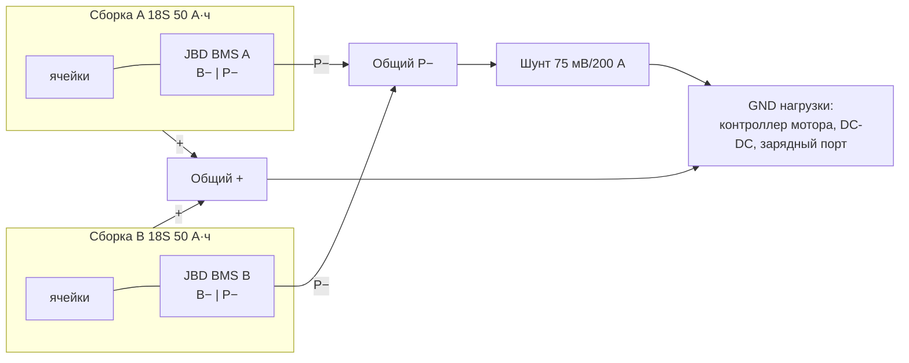

# Счётчик заряда: шунт, INA228, связь с двумя JBD BMS

## Силовая часть

- Шунт **после** объединения P− обеих сборок → меряет общий ток (мотор + электроника + зарядка 100 А).
- Сборки соединяются параллельно только при близком напряжении (ΔV < 0.5 В), иначе — уравнивание через резистор/предзаряд.
- Электроника (ESP, DC-DC) — **после** шунта (со стороны нагрузки), чтобы её потребление тоже учитывалось.

## INA228
```
Шунт Kelvin S+ ──[10 Ом]──┬── IN+      (витая пара, отдельные отводы от силовых болтов)
Шунт Kelvin S− ──[10 Ом]──┼── IN−
                         └─ 100 нФ между IN+ и IN− (дифф. фильтр)
BAT+ ──[10 кОм]──┬── VBUS (до 85 В)
                 └─ 100 нФ → GND
VS = 3.3 В, GND = сторона шунта нагрузки, A0/A1 = GND → адрес 0x40, ALERT — не подключён (опрос по I2C; GPIO47 занят подогревом)
SDA/SCL → GPIO8/9
```
- Разводка: INA228 ближе к шунту, I2C до ESP — экранированный кабель/короткая длина, либо INA228 на основной плате и Kelvin-пара до шунта.

## Изолированный UART к JBD BMS (×2)
```
JBD BMS (разъём UART: GND(B−), RX, TX, [VCC 3.3 В — не у всех]) 
   TX_BMS ─────► ISO7721 VIN_B ... VOUT_A ─► GPIO44 (BMS A RX) / GPIO48 (BMS B RX)
   RX_BMS ◄───── ISO7721 VOUT_B ... VIN_A ◄─ GPIO43 (BMS A TX) / GPIO38 (BMS B TX)
   Сторона BMS питается: VCC с разъёма BMS (если есть) или изолированный B0503S / B0505S + LDO 3.3 В.
```
- Вариант дешевле: две оптопары 6N137 (быстрые) на линию, 9600 бод хватает и для PC817 с подтяжкой 1–2 кОм.
- **Не соединять GND ESP с B− BMS напрямую.**
- Распиновку UART-разъёма уточнить по модели JBD (часто 4-pin JST: GND, RX, TX, VCC 3.3/5 В).
