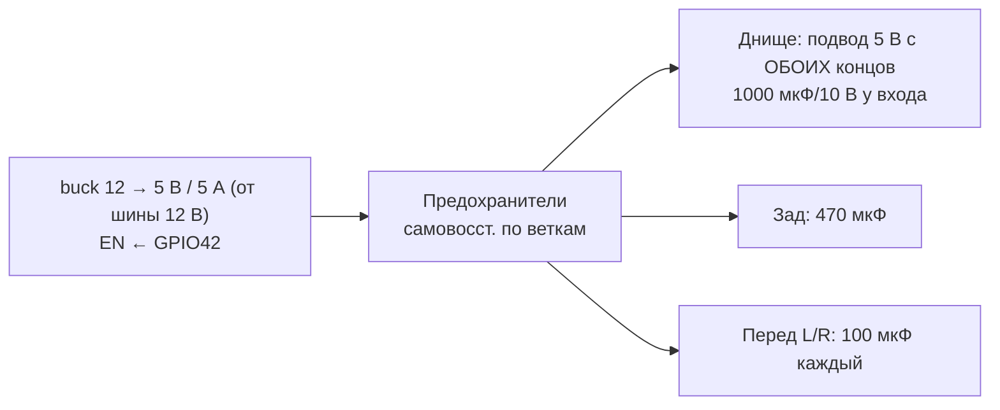

# Адресные ленты: днище, задний фонарь, передние поворотники

## Линии данных
```
GPIO10 ─┐                     ┌─ 1Y ─[330 Ом]─► DIN днища (120 св.)
GPIO11 ─┤  74AHCT125 (VCC=5 В) ├─ 2Y ─[330 Ом]─► DIN заднего фонаря (30 св.)
GPIO12 ─┤  /OE → GND           ├─ 3Y ─[330 Ом]─► DIN переднего L (8 св.)
GPIO13 ─┘                     └─ 4Y ─[330 Ом]─► DIN переднего R (8 св.)
```
74AHCT125 принимает 3.3 В как логическую 1 (VIH = 2.0 В) и выдаёт 5 В — надёжно для WS2812B при 5 В питании.

## Питание 5 В лент

- Бюджет (белый 100 %): 166 св. × 60 мА ≈ 10 А; реально ограничено 3 А программно (`CFG_LED_MAX_MA`). Поворот/стоп (красный/янтарный, ~2/3 каналов) — ~40 мА на светодиод.
- Сечение: днище ≥ 0.75–1 мм², кабели до задней/передней лент 0.5 мм².
- Земля лент и земля ESP — одна точка (звезда) у DC-DC.

## Механика и защита
- Ленты IP67 в силиконовой трубке, торцы — термоусадка с клеем. Днище — в алюминиевом профиле с рассеивателем (защита от камней).
- Разъёмы: JST-SM 3-pin внутри, Julet/Higo 3-pin водонепроницаемые снаружи.
- Длинная линия данных (> 1 м до задней ленты): витая пара данные/GND, резистор 330 Ом на стороне контроллера; при сбоях — «жертвенный» первый светодиод у контроллера.
